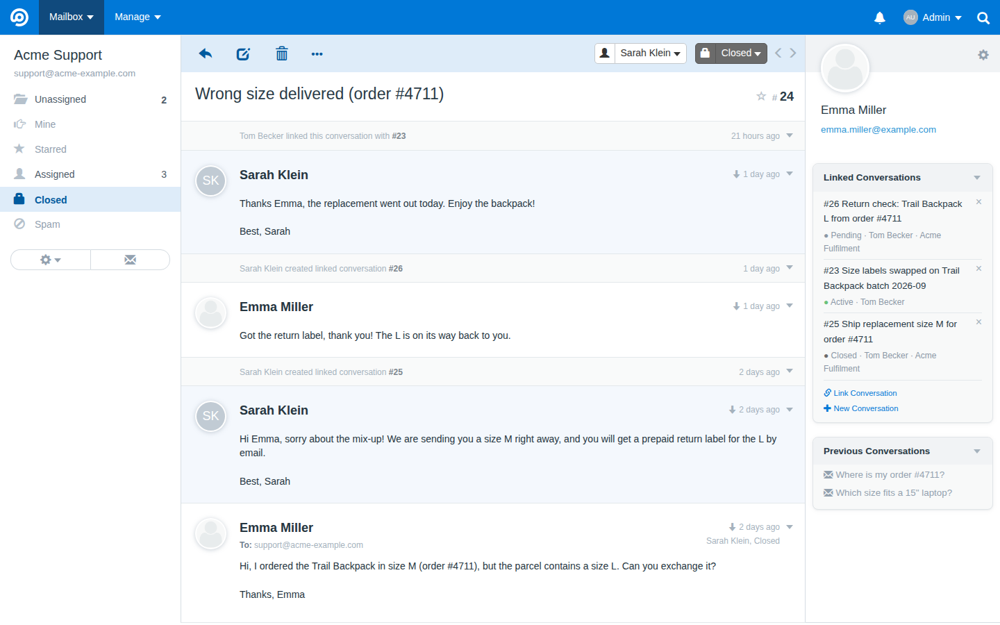
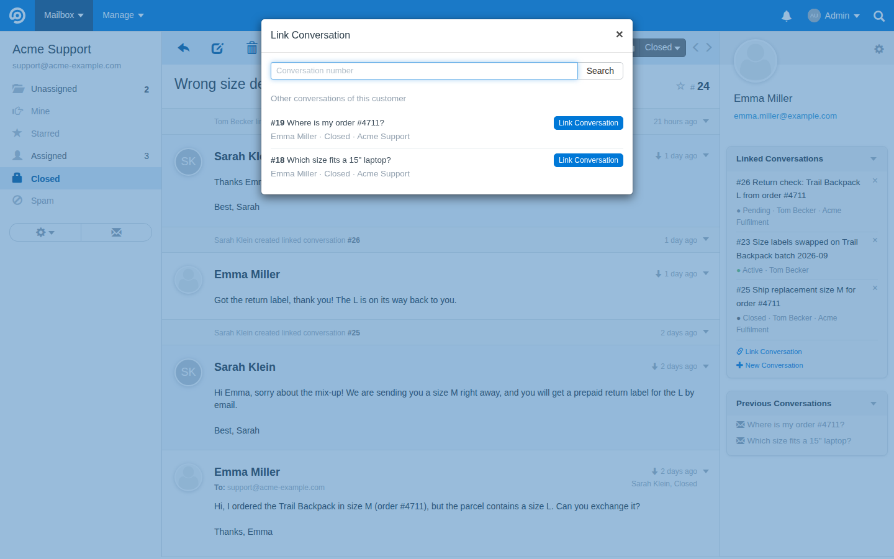
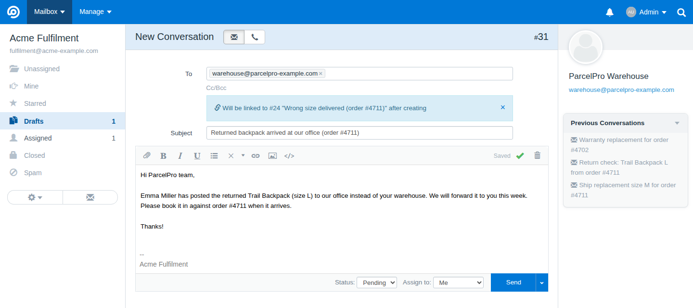
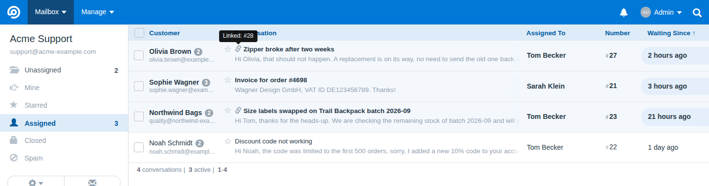

# Linked Conversations — FreeScout module

Link conversations to each other, start a new conversation that is linked to the current one, and see every linked conversation with its status and assignee right in the conversation sidebar.

Typical use: a customer case is solved, but you still need to follow up with a supplier, a fulfilment partner or a colleague in another mailbox. Start a new linked conversation from the customer's conversation; both stay connected, each keeps its own status and assignee, and the follow-up can stay open long after the customer's conversation is closed.

## Screenshots

A closed customer conversation with its follow-ups in the **Linked Conversations** box. Each one shows its status, its assignee and, if it is in another mailbox, the mailbox name. The timeline shows who linked or created which conversation:



**Link Conversation…** finds a conversation by its number and suggests the customer's other conversations:



**New Linked Conversation…** opens FreeScout's normal new-conversation form and links the new conversation once it is created:



In conversation lists, a chain icon marks conversations that have links. Hover over it to see the linked numbers:



## Features

- **Link Conversation…** in the conversation's "More Actions" menu: find a conversation by its number (or pick one of the customer's other conversations) and link it.
- **New Linked Conversation…**: opens FreeScout's normal new-conversation form (saved replies and all other tools work as usual) and links the new conversation to the current one when it is created. Nothing from the current conversation is sent to the recipient.
- **Sidebar box** "Linked Conversations" with number, subject, status, assignee and, when different, the mailbox of every linked conversation. Unlink with ×.
- **Forwarding links automatically**: every forward (manual or by a workflow) links the original and the forwarded conversation. Forwards made before the module was installed are linked once on activation.
- **Chain icon** in conversation lists for conversations that have links; the tooltip lists the linked numbers.
- **Timeline entries** in both conversations when conversations are linked, unlinked or created as linked.
- Links are symmetric and not transitive. Merging conversations keeps their links; deleting a conversation permanently removes them.

## Permissions

Agents can link, unlink and create linked conversations only when they can view both conversations. Linked conversations an agent cannot open are counted in the sidebar but never shown.

## Installation

1. Download `LinkedConversations.zip` from the [latest release](https://github.com/automaze-me/freescout-linked-conversations/releases/latest).
2. Extract it into FreeScout's `Modules/` directory (you get `Modules/LinkedConversations/`).
3. Activate **Linked Conversations** under Manage → Modules.

Requires FreeScout 1.8.160 or newer. Updates are offered on the Modules page.

If your installation keeps `Modules/` outside the FreeScout directory (a symlink, common in Docker images), run **Manage → Tools → Migrate DB** after activating or updating, because FreeScout may skip module migrations there.

## Uninstalling

Deactivating keeps the `conversation_links` table, so re-activating restores all links. While the module is inactive, its timeline entries show as empty grey lines. Deleting the module (not just deactivating it) also leaves the `conversation_links` table and the module's timeline entries (shown as empty grey lines) in place; the table can be dropped manually if no longer needed.

## Development

Tests run against FreeScout's `testing` database connection, with the module active there:

```bash
vendor/bin/phpunit -c Modules/LinkedConversations/phpunit.xml
```

## License

MIT, see [LICENSE](LICENSE).
